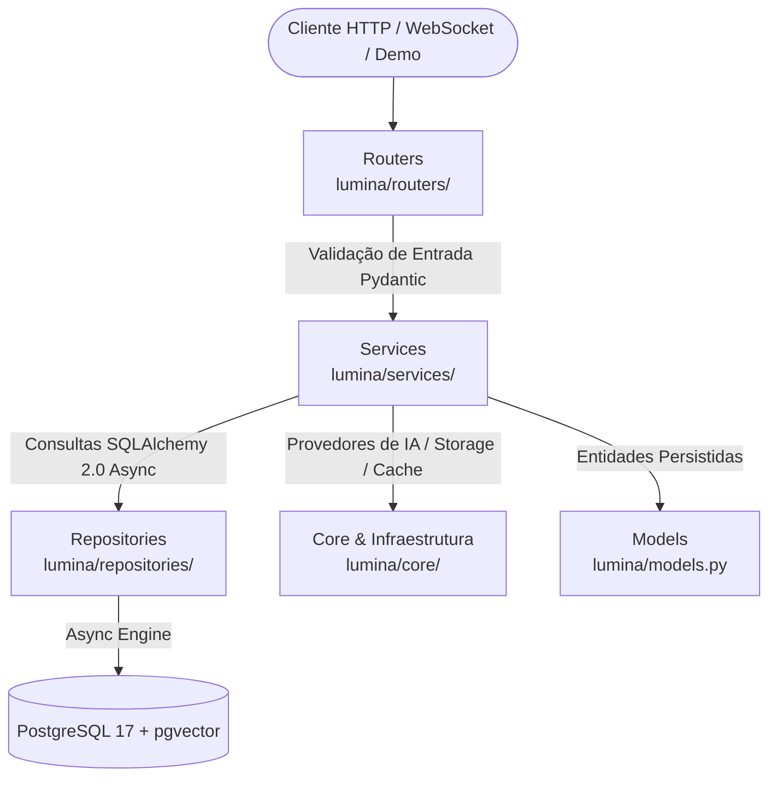
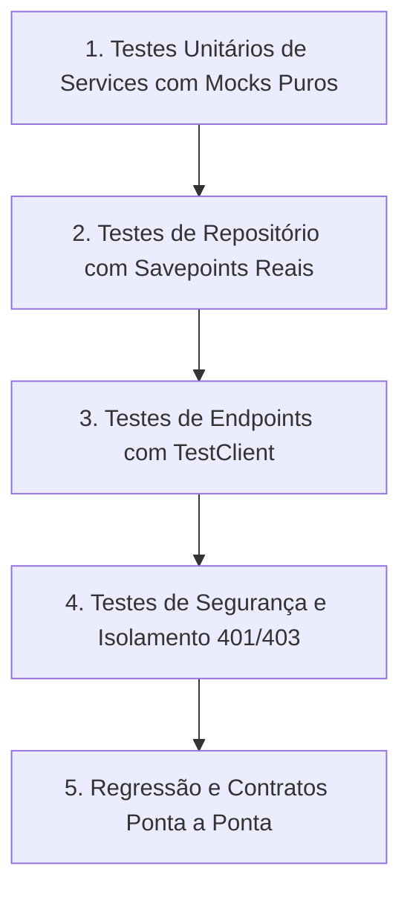
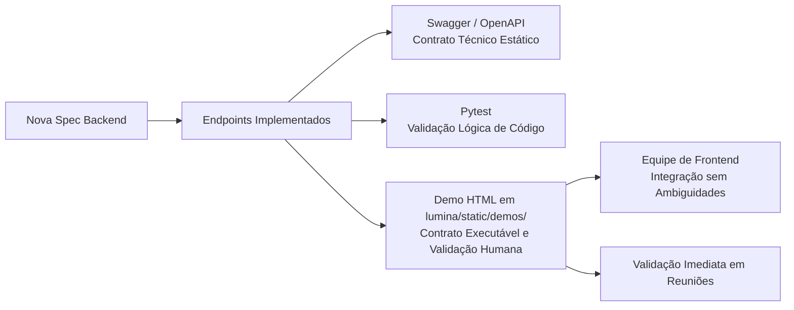

# Arquitetura & Engenharia

Este documento consolida os padrões de engenharia de software, arquitetura em camadas, metodologia de testes e diretrizes de construção de demos que governam o desenvolvimento do **Lumina Back**.

---

## 1. Arquitetura em Camadas (Service-Repository)

O backend adota o padrão de separação rígida de responsabilidades em camadas, garantindo isolamento de regras de domínio, testabilidade unitária e independência de fornecedores de infraestrutura.



### Detalhamento das Camadas:

* **Routers (`lumina/routers/`)**:
  * Recebem requisições HTTP e conexões WebSocket.
  * Validam contratos de entrada através de schemas Pydantic.
  * Injetam dependências (usuário logado, instâncias de services).
  * Retornam respostas com códigos de status adequados.
  * **Regra Rígida**: NUNCA contêm consultas SQL diretas, regras de negócio ou chamadas diretas a provedores de LLM.

* **Services (`lumina/services/`)**:
  * Orquestram todas as regras de domínio, validações de negócio e integrações externas.
  * Coordenam chamadas a repositórios, serviços de IA, storage (S3/local) e cache (Redis).
  * Lançam exceções de negócio e `HTTPException` quando apropriado.

* **Repositories (`lumina/repositories/`)**:
  * Encapsulam consultas SQLAlchemy 2.0 assíncronas puras (`AsyncSession`).
  * Aplicam filtros, joins, agregações e paginação.
  * Respeitam automaticamente a filtragem de exclusão lógica (`deleted_at.is_(None)`).
  * **Regra Rígida**: Repositórios NUNCA lançam `HTTPException`.

* **Models (`lumina/models.py`)**:
  * Entidades mapeadas via SQLAlchemy 2.0 com `Mapped` e `mapped_column`.
  * Todas as entidades de negócio herdam de `AuditMixin`, garantindo rastreamento de autoria (`created_by`, `updated_by`, `deleted_by`), datas (`created_at`, `updated_at`) e suporte a soft delete (`deleted_at`).

* **Schemas (`lumina/schemas/`)**:
  * Modelos de dados Pydantic utilizados para contratos de entrada, saída, filtros e serialização pública.

* **Features (`lumina/features/`)**:
  * Módulos autocontidos para domínios de maior complexidade (ex: `abnt_check/`, `template_check/`).
  * Cada feature encapsula seus próprios schemas, lógica de análise e templates de prompt, sendo orquestrada por um service correspondente.

* **Core (`lumina/core/`)**:
  * Infraestrutura transversal: engine de banco de dados (`database.py`), configurações via `pydantic-settings` (`settings.py`), autenticação JWT e criptografia de senhas (`security.py`), injeção de dependências (`dependencies.py`) e gerenciador de WebSockets (`cache.py`).

---

## 2. Metodologia de Testes Orientados a Risco

A confiabilidade da aplicação é assegurada por uma suíte de testes orientada a **risco e comportamento**, detalhada na skill `.agents/skills/testing-methodology/SKILL.md`.



### As 5 Camadas da Pirâmide:
1. **Unitários de Services (`tests/unit/services/`)**: Validam lógica de negócio pura com mocks completos de repositórios (`AsyncMock`, `pytest-mock`). Execução instantânea.
2. **Integração de Repositórios (`tests/integration/repositories/`)**: Executam queries SQL reais contra PostgreSQL para validar joins, filtros e transações.
3. **API e Routers (`tests/api/routers/`)**: Exercitam requisições completas via `TestClient`, validando status codes, serialização e contratos.
4. **Segurança Transversal**: Validação explícita de recusa de acesso (401 Unauthorized e 403 Forbidden) para diferentes perfis e documentos.
5. **Regressão**: Garantia de que comportamentos corrigidos anteriormente permaneçam estáveis.

### Isolamento de Banco: Testcontainers & Savepoints
* Uma instância real de PostgreSQL 16 é provisionada uma única vez por sessão de testes via **Testcontainers**.
* O esquema DDL é aplicado no início da sessão.
* Cada teste roda dentro de uma transação aninhada (**Savepoint**); ao final do teste, um rollback é executado.
* **Regra Rígida**: NUNCA executar `create_all` ou `drop_all` em testes individuais.

### Separação em 3 Categorias de Testes com IA
Para impedir que a esteira de CI/CD fique lenta, cara ou suscetível a oscilações de rede externa:

| Categoria | Descrição | Consome Tokens? | Onde Executa? |
| :--- | :--- | :---: | :--- |
| **1. AI Integration** | Utiliza o `FakeListChatModel` do LangChain para simular respostas válidas da IA e validar o fluxo do backend. | Não | `poetry run task test` (CI/CD padrão) |
| **2. AI Contract** | Valida como os parsers e services reagem quando a LLM retorna saídas corrompidas ou fora do schema Pydantic esperado. | Não | `poetry run task test` (CI/CD padrão) |
| **3. AI Evaluation** | Executa inferências reais contra modelos externos utilizando datasets de teste padronizados (*golden datasets*). Decorados com `@pytest.mark.ai`. | Sim | `poetry run task test-ai` (Sob demanda local) |

* **Guardrail de Cobertura**: Mínimo de 80% de cobertura geral do código.

### Validação da Ingestão sobre Acervo Anotado
A ingestão (extração do PDF, árvore de seções e fatiamento) não chama modelo, então os testes dela rodam na suíte padrão. Ela depende de heurísticas sobre PDFs reais, e o time mede essas heurísticas contra um acervo anotado à mão.

**Acervo.** `tests/fixtures/documents/<tipo>/` guarda cada PDF uma única vez, separado por tipo de documento (`article`, `systematic_review`, `research_proposal`, `technical_report`). Ao lado de cada PDF fica o gabarito `<nome>.sections.yaml`, com título, página e primeiras palavras de cada seção e subseção. O gabarito descreve o documento, e qualquer teste pode reaproveitá-lo.

**Teste.** `tests/unit/services/test_ingestion_sections.py` encontra os gabaritos sozinho e faz duas verificações:

| Verificação | Classe | Tolerância |
| :--- | :--- | :--- |
| As primeiras palavras de cada seção anotada aparecem no texto dos chunks | Crítica: texto fora dos chunks nunca é recuperado | Zero falhas, por documento |
| A seção aparece no caminho de títulos dos chunks com o título e a página anotados | Métrica da heurística | Piso sobre o acervo inteiro (`MIN_SECTION_IDENTIFICATION_RATE`), com placar impresso por documento |

**Fluxo para um documento novo:**

1. Coloque o PDF em `tests/fixtures/documents/<tipo>/` e escreva o gabarito a partir de `section_template.yaml`. Use aspas simples nos trechos que contêm `: `.
2. Rode `poetry run pytest tests/unit/services/test_ingestion_sections.py -s`. Não é preciso escrever teste novo.
3. Leia o resultado:
    * Teste crítico vermelho: há um defeito na ingestão. Esse teste vermelho é o teste de antes de uma mudança no OpenSpec.
    * Métrica abaixo do piso: decida entre melhorar a heurística, numa mudança no OpenSpec, e baixar o piso com a justificativa registrada na mudança.
    * Tudo verde: o documento passa a proteger a ingestão contra regressões.
4. Para saber como o documento se comportava antes de uma correção, rode o mesmo teste num `git worktree` do commit anterior.

**Piso.** O piso é o placar medido depois da última mudança, arredondado para baixo, e só sobe. Quem melhora a heurística sobe o piso no mesmo commit. O valor vigente fica no próprio teste. A regra completa está na seção "Extração determinística" de `.agents/skills/testing-methodology/references/05-ia.md`.

**Cabeçalhos e rodapés corridos.** A extração apaga do texto, antes da árvore de seções, as caixas de layout que se repetem no topo e na base das páginas. Uma caixa `page-header` ou `page-footer` sai quando o texto dela, sem marcação e com os dígitos trocados por `#`, aparece em 2 páginas ou mais. Outra caixa nos 12% de cima ou de baixo da página sai quando o texto aparece em pelo menos 3 páginas e em 30% delas, e a primeira ocorrência fica. A máscara troca o texto por quebras de linha antes de juntar os espaços, então os deslocamentos não mudam, e os retângulos das citações ignoram as caixas apagadas. O gabarito `<nome>.running.yaml` lista as linhas que não podem chegar aos chunks e as que precisam ficar, e `tests/unit/services/test_ingestion_running_lines.py` confere os dois casos com tolerância zero, por documento:

```bash
poetry run pytest tests/unit/services/test_ingestion_running_lines.py
```

### Validação da Recuperação sobre Acervo Anotado
A recuperação de evidências decide quais trechos chegam ao avaliador de cada critério. O time mede o comportamento atual contra o mesmo acervo, com um segundo gabarito por documento.

**Gabarito.** `<nome>.retrieval.yaml` fica ao lado do PDF e do `<nome>.sections.yaml`. Ele guarda a árvore de critérios (tipificação, taxonomia e ramo) e, em cada ramo, os trechos que a recuperação precisa devolver: página, um trecho de até cerca de 150 caracteres copiado do PDF e, quando o trecho pertence a uma seção anotada, a seção. Expansões de consulta e requisito de seção entram como campos opcionais do ramo. O modelo comentado fica em `tests/fixtures/documents/retrieval_template.yaml`. A leitura dos dois gabaritos fica em `tests/fixtures/answer_keys.py`.

**Comparação de texto.** Os dois testes comparam o trecho com o texto dos chunks depois de `normalize`: sem marcação Markdown e HTML, sem os prefixos `[título]`, com espaços juntos e sem diferença de caixa. Aspas curvas contam como retas e travessões contam como hífen, então o anotador pode digitar o trecho sem reproduzir a tipografia do PDF. Em tabelas, o extrator ainda mantém palavras partidas por hífen (`net-‖works`, issue #25): escolha a parte do trecho que não quebra.

**Acervo atual.** Três documentos têm gabarito de recuperação: o anteprojeto, com a árvore de Validação de Ante-Projeto, e as duas revisões sistemáticas, com a árvore de Revisão Sistemática da Literatura.

**Testes.**

| Teste | Onde roda | Verifica | Tolerância |
| :--- | :--- | :--- | :--- |
| `tests/unit/services/test_retrieval_answer_keys.py` | Suíte padrão, sem IA | Cada trecho está no texto anonimizado da página e da seção anotadas, e cada seção existe no `.sections.yaml` | Zero falhas, por documento |
| `tests/ai/evaluation/retrieval/test_retrieval_baseline.py` | `poetry run task test-ai` (embeddings reais e pgvector) | Nenhuma evidência vem de outro documento | Zero falhas, por documento |
| O mesmo arquivo | O mesmo | Recall de trechos, acerto de seção e página, precisão entre ramos e acerto do roteamento por seção | Piso por métrica sobre o acervo inteiro, com placar impresso por ramo |

O teste de avaliação ingere os PDFs anotados por `run_document_ingestion` e chama `retrieve_criteria_payload` para cada ramo, como `/release` faz. A precisão entre ramos conta os blocos devolvidos que contêm trecho do próprio ramo, entre os blocos que contêm trecho de algum ramo do documento. Ela cai quando um ramo recebe a evidência de um vizinho.

**Fluxo para um gabarito novo:**

1. Escreva `<nome>.retrieval.yaml` a partir de `retrieval_template.yaml`.
2. Rode `poetry run pytest tests/unit/services/test_retrieval_answer_keys.py`. Se falhar, a mensagem mostra onde o trecho aparece no documento: corrija a página ou a seção, ou troque um trecho que a anonimização alterou.
3. Rode `poetry run pytest tests/ai/evaluation/retrieval -s --run-ai -m ai` e leia o placar. Uma métrica abaixo do piso pede a mesma decisão da ingestão: melhorar a recuperação numa mudança do OpenSpec ou baixar o piso com a justificativa registrada.

**Pisos.** Os quatro pisos (`MIN_EVIDENCE_RECALL`, `MIN_SECTION_PAGE_HIT_RATE`, `MIN_BRANCH_PRECISION`, `MIN_ROUTING_HIT_RATE`) ficam no teste de avaliação. Cada um recebe o menor valor de três execuções, arredondado para baixo na segunda casa decimal, e só sobe.

### Validação da Seleção de Seções e dos Veredictos
A avaliação usa a seleção de seções pelo sumário, e não mais a recuperação vetorial (`docs/ia-plataforma.md`, "Seleção de Seções por Critério"). Os mesmos gabaritos `<nome>.retrieval.yaml` medem a seleção e o veredicto. Cada ramo com evidência traz `fulfilled`: `true` só quando o documento atende o critério por inteiro; atendimento parcial é `false`; ramo com `evidence: []` é `false`.

| Teste | Onde roda | Verifica | Tolerância |
| :--- | :--- | :--- | :--- |
| `tests/unit/services/test_retrieval_answer_keys.py` | Suíte padrão, sem IA | `fulfilled` booleano, presente nos ramos com evidência e nunca `true` num ramo vazio | Zero falhas, por documento |
| `tests/ai/evaluation/retrieval/test_outline_selection.py` | `poetry run task test-ai` | Recall de trechos no contexto selecionado, acerto de inexistência (ramos vazios encerrados como "não existe") e segurança de inexistência (ramos com evidência que não foram encerrados assim) | Piso por métrica sobre o acervo |
| `tests/ai/evaluation/verdicts/test_verdict_accuracy.py` | `poetry run task test-ai` | Acerto de `fulfilled` da avaliação contra o anotado, com matriz de confusão por documento | Piso sobre o acervo |
| `tests/integration/test_release_pipeline.py` | Suíte padrão, modelos falsos | Todo critério recebe veredito, "não existe" não chama o avaliador e a seleção fica gravada | Zero falhas |

Os testes com IA compartilham `tests/ai/evaluation/support.py` (base vetorial, ingestão, entrada do ramo e seleção por gabarito) e a fixture `indexed_vectorstore` de `tests/ai/evaluation/conftest.py`, que ingere o acervo uma vez por sessão. A seleção roda em memória sobre os chunks anonimizados, sem PGVector.

**Pisos.** `MIN_SELECTION_RECALL`, `MIN_NOT_FOUND_HIT_RATE` e `MIN_NOT_FOUND_SAFETY` ficam no teste do seletor, e `MIN_FULFILLED_ACCURACY` no teste de veredictos, com a mesma regra dos outros pisos. Na troca, a recuperação vetorial tinha recall de 0,44 e acerto de `fulfilled` de 0,79 (mediana de três execuções); o seletor chegou a 0,87 e 0,86 com o `gpt-6.1-sol` como avaliador. Por custo, o avaliador passou a ser o `gpt-6-luna` com `reasoning.effort = medium`, e o acerto ficou em 0,79. Os testes do seletor e de veredictos imprimem o consumo de tokens por etapa.

**Depuração.** Com `DEBUG_INGESTION_AUDIT=True`, `05_outline/<documento>.md` mostra o sumário que o seletor recebeu e `06_selection/<documento>/<critério>.md` mostra cada rodada, o contexto enviado ao avaliador e o veredito.

---

## 3. Segurança e Privacidade por Padrão

* **Autenticação**: Tokens JWT (`HS256`) com segredo robusto e hash de senhas via algoritmo **Argon2** (`pwdlib`).
* **Autorização Contextual**: Acesso a recursos controlado por matriz de permissões (`AccessType`: owner, advisor, viewer), validada em services antes de repassar chamadas ao repositório.
* **Exclusão Lógica Obrigatória (Soft Delete)**: Entidades com `AuditMixin` utilizam `deleted_at` e `deleted_by`. Exclusões físicas são expressamente vedadas em rotinas normais de negócio.
* **Trilha de Auditoria**: Operações críticas de mutação (CREATE, UPDATE, DELETE) geram registros imutáveis na tabela `audit_logs` via `audit_service`.
* **Proteção LGPD**: Dados pessoais sensíveis são anonimizados antes de qualquer envio a provedores externos de IA via Microsoft Presidio.

---

## 4. Guia de Demos HTML de Validação (Princípio VII)

Toda especificação (spec) que adicionar ou alterar comportamento observável no backend DEVE incluir uma **página HTML funcional de demonstração e validação**.

Esta página NÃO é um frontend de produto: trata-se de um artefato pragmático de validação, documentação viva e referência executável.



### Objetivos da Demo:
1. **Validação Manual Imediata**: Permitir que o desenvolvedor valide o fluxo ponta a ponta sem depender de Postman ou comandos curl complexos.
2. **Contrato Executável para o Frontend**: Serve de espelho funcional para os desenvolvedores de interface compreenderem os cabeçalhos, payloads de envio, respostas reais e fluxos de erro.
3. **Demonstração Executiva**: Permite demonstrar o valor de negócio em reuniões sem precisar esperar o frontend de produção.

### Diretrizes Técnicas de Construção:
* **Zero Build Step**: Construída estritamente com HTML5 semântico, estilos limpos (CSS vanilla ou Tailwind CSS via CDN) e JavaScript moderno (`fetch`, `async/await`). É PROIBIDO o uso de frameworks pesados (React, Vue, Angular) ou bundlers para páginas de demo.
* **Servida pelo Próprio FastAPI**: As demos residem em `lumina/static/demos/<nome-da-spec>/` e são servidas diretamente pelo FastAPI em `/demos/<nome-da-spec>/`. NUNCA crie servidores web ou processos paralelos.
* **Catálogo Central**: Toda nova demo deve ser listada com título e descrição no índice geral em `lumina/static/demos/index.html`.
* **Consumo Real**: A demo consome diretamente os endpoints reais da API em execução.
* **Autenticação e Personas**: A demo deve conter controles visuais para informar token JWT ou alternar rapidamente entre personas de teste (ex: Aluno, Orientador, Administrador).
* **Transparência Visual**:
  * Campos claros para parâmetros de entrada;
  * Botões autoexplicativos para disparar ações;
  * Indicador visual de processamento em andamento;
  * Exibição legível do status HTTP e payload JSON retornado;
  * Alerta visual explícito (etiquetas destacadas) em ações que persistam ou alterem dados reais no banco de dados.

### Desacoplamento Absoluto:
* A demo NÃO pode conter lógica de negócio no JavaScript; toda regra reside no backend.
* Nenhuma parte da aplicação de produção pode depender da existência da demo.
* A demo deve poder ser excluída a qualquer momento com zero impacto no sistema.
* NUNCA crie rotas inseguras ou contorne proteções de autenticação para facilitar a demo.

### Checklist de Definição de Concluído (DoD):
- [ ] Backend implementado e aderente à arquitetura em camadas.
- [ ] Testes automatizados cobrindo a matriz de risco.
- [ ] Página HTML de validação criada em `lumina/static/demos/<spec-name>/`.
- [ ] Card descritivo adicionado em `lumina/static/demos/index.html`.
- [ ] Página servida diretamente pela montagem `/demos/` do FastAPI.
- [ ] Fluxo de autenticação/personas funcionando na interface.
- [ ] Todos os critérios de aceitação exercitáveis manualmente pela página.
- [ ] Payloads de sucesso e de erro visíveis de forma clara.
- [ ] Resumo funcional documentado no MkDocs.
- [ ] Validação de zero acoplamento (a demo pode ser removida sem afetar o sistema).
